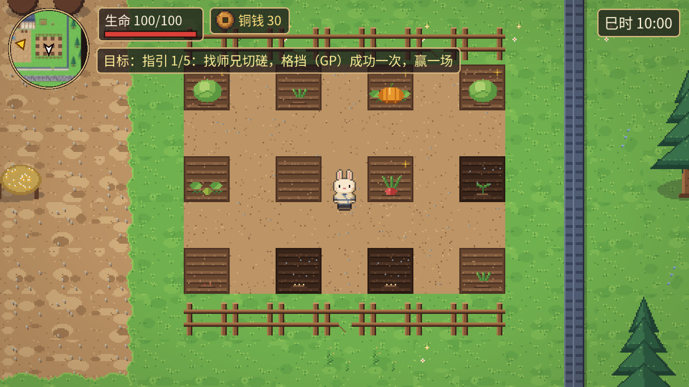
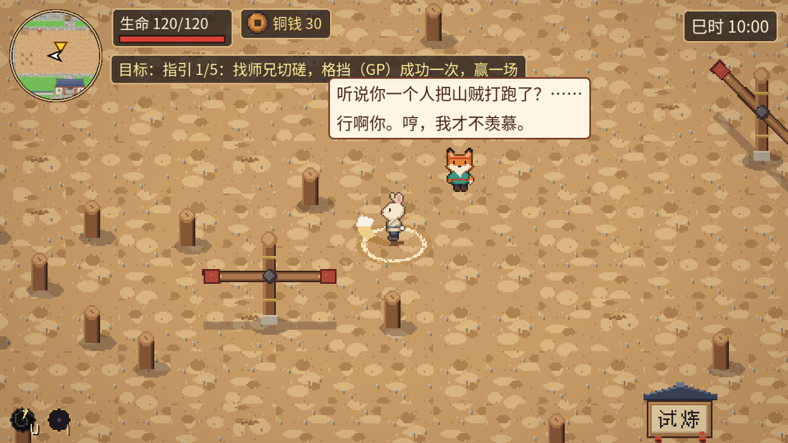
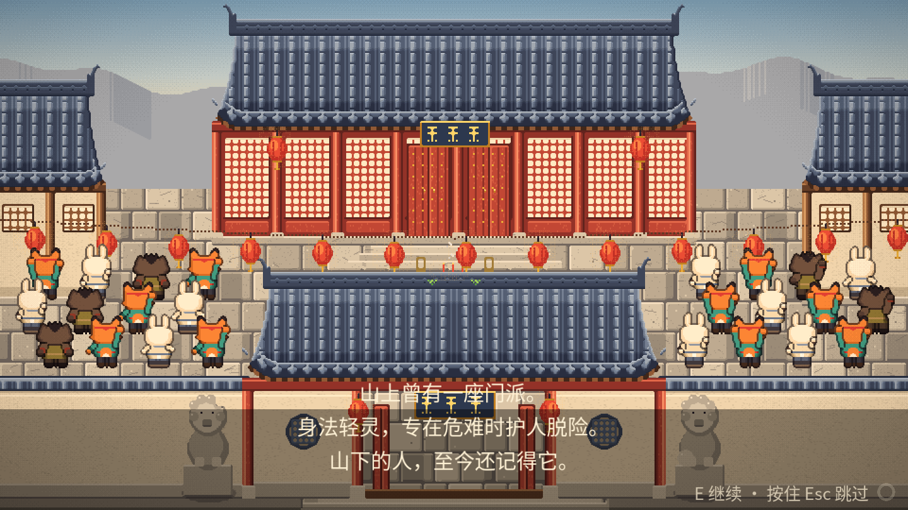
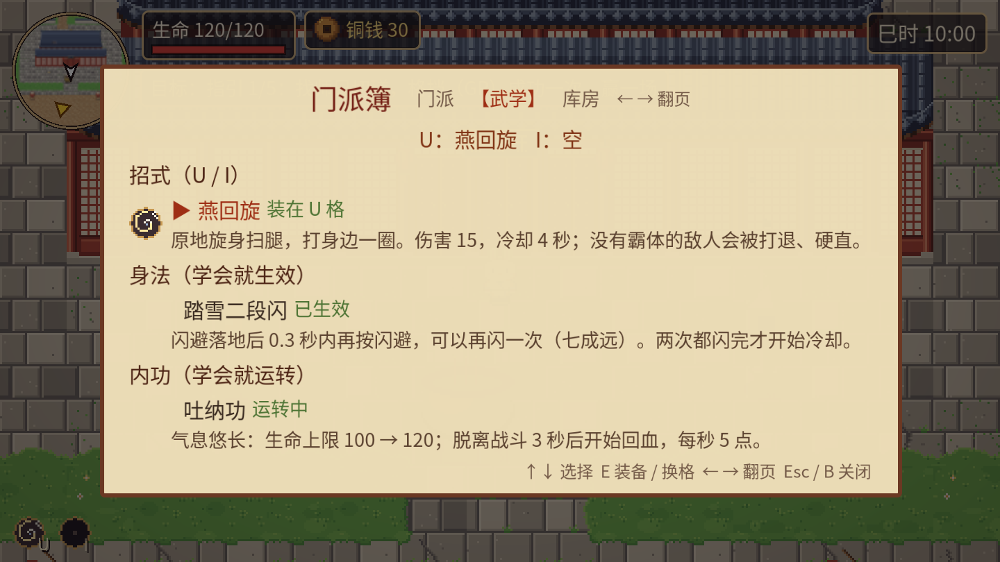

# 山门小院 · The Mountain Courtyard

### ▶ [点这里直接在浏览器里玩 / Play in your browser](https://19sw.github.io/rabbit-game/)

> 请用电脑打开（键盘操作），首次加载约 27 MB。
> Desktop browser recommended (keyboard controls). First load is ~27 MB.

一款 2D 像素风、俯视角的种田经营 + 动物武侠小游戏。你给小兔起个名字，扮演破旧山门里的弟子：开垦菜园、采药挖笋、收徒派活，跟师父学新招式，接江湖悬赏、参加村口比武，一点点把门派重新撑起来。

A top-down 2D pixel-art farming & sect-management game with animal wuxia. Name your rabbit disciple of a run-down mountain sect: farm the garden, gather herbs, take in apprentices, learn new martial moves from your master, take on bounties and compete in the village tournament, and slowly rebuild the sect.

| | |
|---|---|
|  |  |
|  |  |
|  |  |
|  |  |

## 操作 / Controls

| 按键 Key | 作用 Action |
|---|---|
| `W A S D` / 方向键 Arrows | 走动 Move |
| `J` / 鼠标左键 Left click | 攻击（两连击）Attack (2-hit combo) |
| `K` / 鼠标右键 Right click | 格挡（GP）Guard / parry |
| `空格 Space` / `Shift` | 闪避 Dodge |
| `U` / `I` | 招式 1 / 招式 2 Martial moves |
| `E` | 交谈 / 查看 / 坐下 Talk / Interact / Sit |
| `Q` | 任务面板 Quest panel |
| `B` | 门派簿（门派 / 武学 / 库房）Sect book |
| `T` | 时间快进 1 小时 Skip 1 hour |
| `Esc` | 暂停 + 按键说明 + 改名 Pause + help + rename |

## 内容 / Features

- **给主角起名 Name your hero** — 新游戏时起名，Esc 页随时可改
- **开场过场 Opening cutscene** — 7 张高清像素插画，平稳运镜
- **菜园与库房 Farming** — 开垦并扩建到 12 块地，打水浇菜，青菜 / 萝卜 / 南瓜，卖给厨娘
- **采集与药膳 Gathering** — 竹笋、草药每天重生，药膳提升生命上限
- **武学 Martial arts** — 师父传功：燕回旋、吐纳功、踏雪二段闪，各有新特效和音效
- **动作战斗 Action combat** — 连击、格挡反击、闪避、Boss 狂暴阶段
- **昼夜与作息 Day/night & schedules** — NPC 夜里回去睡觉，可以坐下打坐、等到天亮
- **门派经营 Sect management** — 铜钱、修缮建筑、小食摊、收徒派活（帮厨 / 陪练 / 打扫 / 种地）
- **江湖告示榜 Quest board** — 悬赏怪物、每日委托
- **村口比武大会 Tournament** — 三轮擂台，普通 / 困难两档
- **中英双语 Chinese / English** — 随时切换
- **浏览器存档 Browser save** — 自动保存到本地浏览器

## 技术 / Tech

- 引擎 Engine：Godot 4.7.2（GDScript，Compatibility 渲染器）
- 导出 Export：Web（单线程版本，可直接部署在 GitHub Pages 等静态网站上）
- 美术 Art：全部由 Python 代码生成的像素画（Pillow），对话头像、封面和开场插画为 2 倍像素密度的高清版
- 数值与内容数据化 Data-driven：战斗数值卡 `game2d/cards/*.tres`，经济 / 任务 / 菜园 / 武学表 `game2d/data/*.json`
- 自动化测试 Automated tests：`game2d/tests/`（1000+ 项无界面玩法与界面排版测试）

## 目录 / Layout

| 路径 Path | 内容 Content |
|---|---|
| `game2d/` | Godot 工程源码 Project source |
| `docs/` | 打包好的网页版（GitHub Pages 从这里发布）Exported web build served by GitHub Pages |
| `media/` | 截图 Screenshots |

本地运行 Run locally：用 Godot 4.7.2 打开 `game2d/project.godot`。
