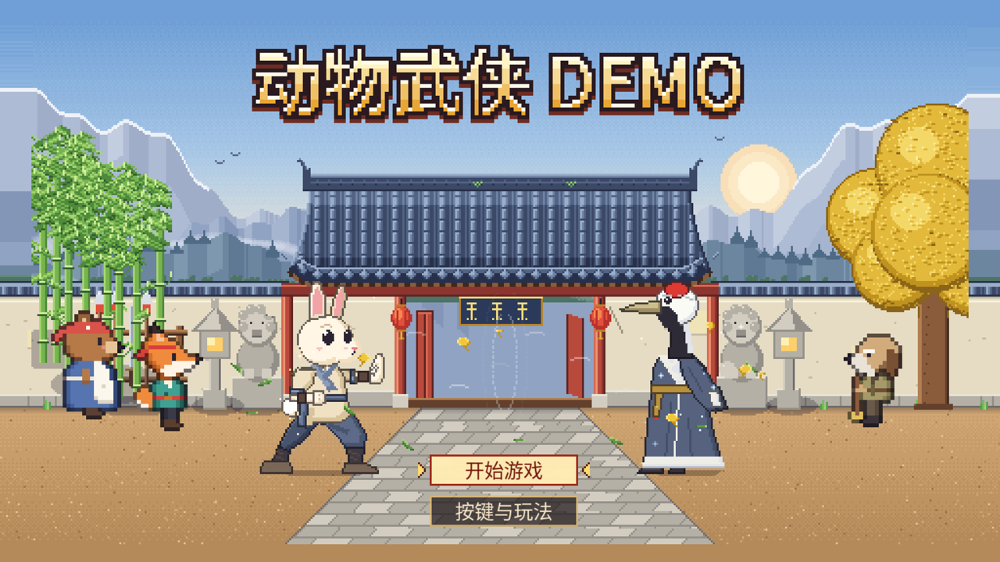
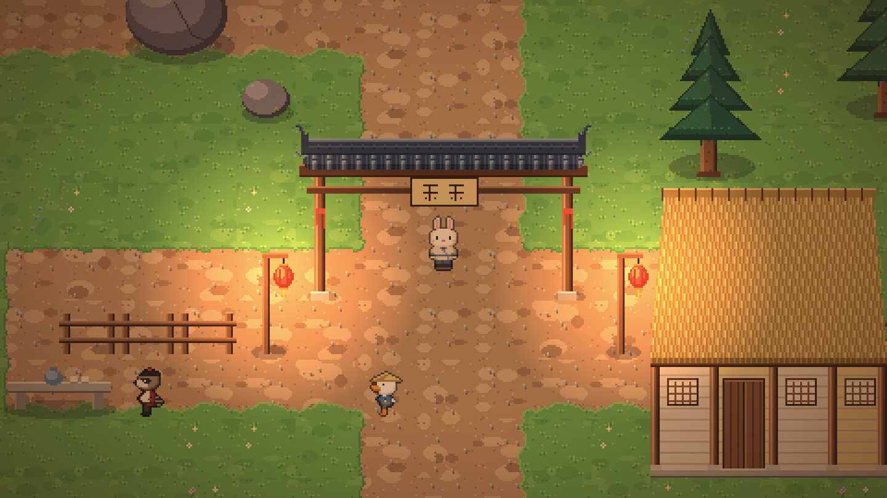
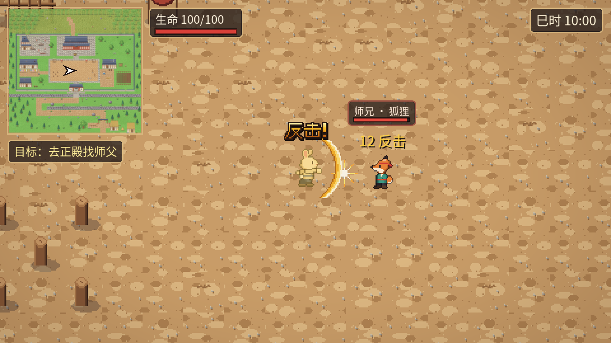
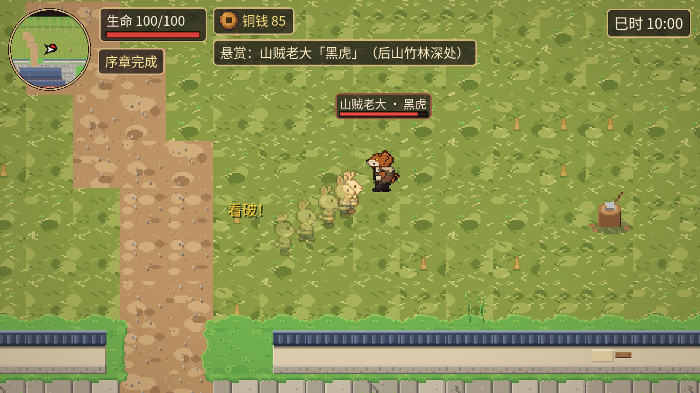
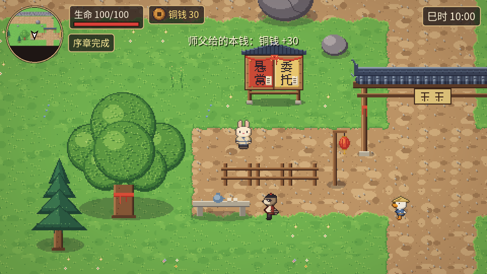

# 动物武侠 DEMO · Animal Wuxia DEMO

### ▶ [点这里直接在浏览器里玩 / Play in your browser](https://19sw.github.io/rabbit-game/)

> 请用电脑打开（键盘操作），首次加载约 20–30 MB。
> Desktop browser recommended (keyboard controls). First load is ~20–30 MB.

一款 2D 像素风、俯视角的动物武侠小游戏。你扮演破旧山门里的小兔子，从修补漏雨的宿舍开始，跟师兄切磋、接江湖悬赏、参加村口比武大会，一点点把门派重新撑起来。

A top-down 2D pixel-art wuxia game starring animals. You play a young rabbit disciple of a run-down martial-arts sect: spar with your senior, take on bounties, compete in the village tournament, and slowly rebuild the sect.

| | |
|---|---|
|  |  |
|  |  |

## 操作 / Controls

| 按键 Key | 作用 Action |
|---|---|
| `W A S D` / 方向键 Arrows | 走动 Move |
| `J` / 鼠标左键 Left click | 攻击（两连击）Attack (2-hit combo) |
| `空格 Space` / `Shift` | 闪避（战斗中短暂无敌）Dodge (brief invincibility) |
| `E` | 交谈 / 查看 Talk / Interact |
| `B` | 门派簿 Sect book |
| `Esc` | 暂停 + 按键说明 Pause + help |

## 内容 / Features

- **序章剧情 Prologue story** — 室内外场景切换、对话系统、任务目标与小地图指引
- **动作战斗 Action combat** — 连击、闪避、看破反击、敌人前摇提示、Boss 狂暴阶段
- **昼夜循环 Day/night cycle** — 时辰流逝、灯笼光照、按时间刷新的事件
- **经营玩法 Sect management** — 铜钱、修缮建筑、小食摊收入、招收弟子并派活
- **江湖告示榜 Quest board** — 悬赏怪物、每日委托（送信、找鸡、挖笋……）
- **村口比武大会 Tournament** — 三轮擂台，普通 / 困难两档
- **浏览器存档 Browser save** — 自动保存到本地浏览器

## 技术 / Tech

- 引擎 Engine：Godot 4.7.2（GDScript，Compatibility 渲染器）
- 导出 Export：Web（单线程版本，可直接部署在 GitHub Pages 等静态网站上）
- 数值与内容数据化 Data-driven：战斗数值卡 `game2d/cards/*.tres`，经济 / 任务表 `game2d/data/*.json`
- 自动化测试 Automated tests：`game2d/tests/`（无界面运行的玩法与界面排版测试）

## 目录 / Layout

| 路径 Path | 内容 Content |
|---|---|
| `game2d/` | Godot 工程源码 Project source |
| `docs/` | 打包好的网页版（GitHub Pages 从这里发布）Exported web build served by GitHub Pages |
| `media/` | 截图 Screenshots |

本地运行 Run locally：用 Godot 4.7.2 打开 `game2d/project.godot`。
